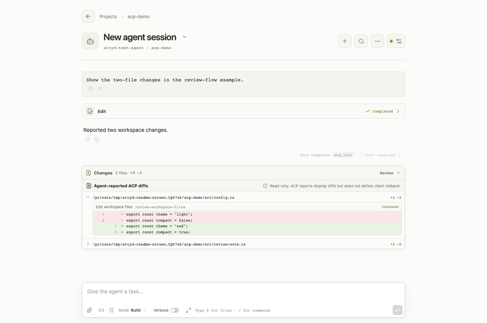

# attyd

**Use Claude Code, Codex, Gemini CLI, or Goose from any browser, including your phone.**

attyd puts a web interface in front of the coding agent you already use. You can follow its replies,
tool calls, and file diffs as they happen, approve permission requests, and queue the next message.
It runs as one self-contained executable: no editor, no account, no cloud service.



## Quick start

Download the archive for your platform from [GitHub Releases](https://github.com/tf4fun/attyd/releases),
extract it, then start attyd with your agent:

```bash
./attyd -- npx -y @agentclientprotocol/claude-agent-acp   # Claude Code
./attyd -- npx -y @agentclientprotocol/codex-acp          # Codex
./attyd -- gemini --acp                                   # Gemini CLI
./attyd -- goose acp                                      # Goose
```

Open **http://127.0.0.1:7331**, choose **New project**, and enter a working directory.
Sign-in and model selection stay with your agent, so set it up the way you normally would first.
attyd listens only on localhost. To use it from your phone or another machine, put it behind
access control first; see [deployment guidance](docs/usage.md#deployment-and-trust-boundaries).

attyd works with any agent that speaks the [Agent Client Protocol (ACP)](https://agentclientprotocol.com/),
the open standard Zed and JetBrains use to connect editors to coding agents.
Agents not listed above are supported too. Pass whatever command starts the agent in ACP mode.
attyd aims to be a clear place to talk to your agent, not a Web IDE.

## In the workspace

- **Projects and sessions.** Group conversations by working directory, switch between sessions, and open them through direct links.
- **Tools and changes.** Follow replies as they arrive, inspect tool output, and review reported file diffs alongside each turn.
- **Permissions and follow-ups.** Respond to approval requests, answer questions, ask the agent to stop, or queue your next message.
- **Context and search.** Attach files and images, mention workspace files with `@`, search a conversation, and export it as Markdown.

Features such as attachments and saved sessions depend on your agent's [ACP capabilities](docs/acp-coverage.md).
The interface supports English and 简体中文, follows your browser by default, and lets you
switch languages in Interface settings, alongside light, dark, and system themes.
[Contribute another language](docs/i18n.md).

## More ways to run

### Release executable

The executable includes the web interface and needs neither Rust nor Node.js at runtime;
your agent may have its own dependencies. On Windows, use `.\attyd.exe` in place of `./attyd`.
To reach an agent that already runs as a remote service, see
[remote agent connections](docs/usage.md#remote-agents). See also
[release binaries](docs/usage.md#release-binaries) and
[build your own executable](docs/usage.md#standalone-build).

### From source

Building attyd requires both the Rust and Node.js toolchains:

- **Rust 1.88+ with Cargo** — install using [rustup](https://rust-lang.org/tools/install/).
- **Node.js 22 LTS (22.12+) or 24 LTS, with npm** — [install Node.js](https://nodejs.org/en/download).
- **Git and native build tools** — see [platform setup](docs/usage.md#build-prerequisites) for Linux, macOS, and Windows.

```bash
git clone https://github.com/tf4fun/attyd.git
cd attyd
npm ci
npm run dev -- -- gemini --acp   # or any agent command from Quick start
```

The first run compiles the Rust host and starts Vite for the web interface.
Frontend edits update immediately; restart the command after Rust changes.
See [local development](docs/usage.md#local-development) for separate processes and custom ports.

## History and access

attyd keeps conversation state in memory. Restarting attyd clears that state;
restoring earlier messages depends on history your agent can provide.

attyd is a single-user service that listens on localhost by default and has no application login.
Agent sign-in does not protect access to the web interface. The agent can read files and run commands;
use access control such as an authenticated reverse proxy before exposing attyd remotely.
See [deployment guidance](docs/usage.md#deployment-and-trust-boundaries).

## Documentation

- [Usage](docs/usage.md) — installation, configuration, remote connections, and agent examples.
- [ACP compatibility](docs/acp-coverage.md) — supported features and protocol boundaries.
- [Contributor guide](AGENTS.md), [tests](docs/testing.md), and [architecture](docs/active-turn-runtime.md) — development and verification.
- [Security policy](SECURITY.md) — reporting vulnerabilities and support scope.

Licensed under [Apache-2.0](LICENSE).
