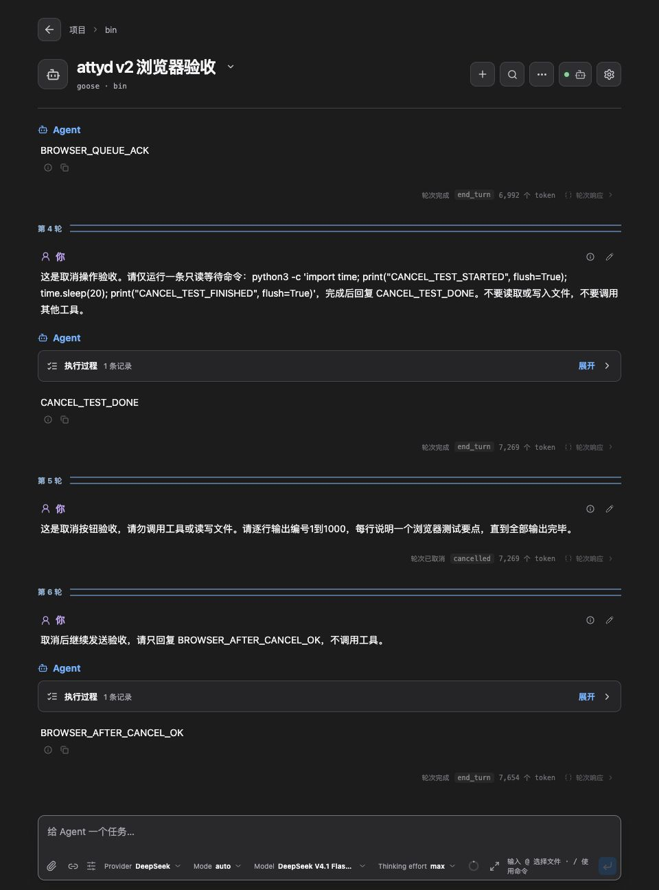

# v2 功能矩阵与手工验收

本页把用户可见功能对应到手工步骤、预期结果和已有回归入口，供版本验收与问题复测使用。
用例编号保持稳定；新增用例追加编号，不因排序变化而重编。

行为规则以 [协议](protocol.md)、[内存模型](bridge-memory-model.md) 和
[ACP 功能矩阵](acp-bridge-matrix.md) 为准；协议级验收见
[编号验收用例](protocol-acceptance.md)，自动化命令与环境见 [测试指南](testing.md)。
本页不重新定义协议，也不把一次浏览器测试当作全部功能通过。

## 1. 怎样执行一轮验收

1. 记录被测提交、实际运行的二进制来源、Agent/模型、浏览器、工作目录和协商能力。
   本地分支与二进制可能不同，不能只写分支名。优先使用对应提交已通过 GitHub CI 的构建。
2. 新建专用验收会话 A；另开一个标签页 B 跟随同一会话。跨项目、删除和文件写入使用
   单独的测试目录或测试会话，不能拿日常工作会话作样本。
3. 每次构建先跑 **M01、M03–M08、M10、M12、M24**；准备发布或相关功能变化时，
   补做其余适用项。长历史、移动端、交互和恢复场景需要各自的样本，不能由简单聊天代替。
4. 每项按“操作 → 观察 → 证据”记录结果；发现失败就记录最短复现路径，关联 issue，
   修复后复测该项及直接关联项。
5. 收尾时确认没有待发送消息、运行中的测试任务或待答复交互；恢复临时改动的界面设置，
   关闭多余标签页，保留需要复核的会话和证据。

结果统一使用以下状态，**不预先勾选通过**：

| 状态 | 含义 |
| --- | --- |
| 通过 | 在所记录的环境里执行了该项适用步骤，观察结果符合预期 |
| 部分通过 | 已测子项符合预期，仍有子项未执行或阻塞；逐一写明，不能算整项完成 |
| 失败 | 已执行并出现可说明的偏差；附复现、证据和 issue |
| 阻塞 | 账号、服务、网络或样本条件不足，无法继续判断；写明原因 |
| 不适用 | 用例的能力或平台前提不成立，例如 Agent 未协商该能力；写明依据。本轮未覆盖或没有准备样本仍记未执行 |
| 未执行 | 尚未操作；有自动化参考、按钮可见或其他用例通过均不能替代执行 |

同一项只完成部分步骤时，列出已测子项，其余仍记为未执行。
“Agent 不支持”与“已声明支持但产品行为错误”要分开：后一种应记失败。

## 2. 功能与手工步骤矩阵

表中自动化链接用于定位相关回归，不表示某个文件已穷尽这一行的全部步骤，
也不代表本轮重新运行过这些测试。

| ID | 功能 / 前提 | 手工步骤与预期结果 | 自动化参考 |
| --- | --- | --- | --- |
| M01 | 项目与会话导航 | 打开首页 → 项目 → 已有会话，再返回项目；项目路径、会话标题和返回位置正确，加载状态能结束 | [ACP UI](../tests/browser/acp-ui.pw.ts)、[加载界面](../tests/browser/session-loading.pw.ts) |
| M02 | 列表筛选与跨项目 | 在项目列表、项目会话列表和会话切换器分别筛选；只命中对应范围。进入另一个测试工作目录创建会话，URL 与 Agent 报告的 cwd 一致 | [ACP UI](../tests/browser/acp-ui.pw.ts)、[项目投影](../tests/project-browser.test.tsx) |
| M03 | 创建会话 | 在选定项目中新建会话，核对工作目录后创建；出现独立会话 URL、空对话和可用输入框，未发送消息时不应出现虚构轮次 | [ACP UI](../tests/browser/acp-ui.pw.ts) |
| M04 | 历史加载与刷新 | 直接打开已有会话 URL，核对轮次、提示词、回复和已完成/已取消状态；刷新并在新标签页打开，内容不重复、不丢失 | [ACP UI](../tests/browser/acp-ui.pw.ts)、[完整执行历史](../tests/browser/lazy-process.pw.ts) |
| M05 | 发送文本与 Markdown | 空闲时发送含中文、粗体和行内代码的短提示词；已发消息立即进入对话而非一直停在队列，回复格式正确，一次发送只形成一个新轮次 | [ACP UI](../tests/browser/acp-ui.pw.ts)、[提示词折叠](../tests/browser/prompt-folding.pw.ts)、[客户端写入](../tests/write-client.test.ts) |
| M06 | 增量文字与中间消息 | 使用 §3 的流式任务；在轮次完成前看到工具前文字，工具后回复逐步增长，最终内容顺序为文字 → 工具 → 文字。需要实际观察中途状态，只有完成截图不算通过 | [ACP UI](../tests/browser/acp-ui.pw.ts)、[轮次折叠](../tests/browser/turn-collapse.pw.ts) |
| M07 | 执行过程与工具详情 | 打开一条已有工具记录的会话，展开/收起执行过程，再展开/收起工具输入与输出；内容、状态与轮次归属正确，操作没有明显卡顿，刷新后记录仍可查看 | [完整执行历史](../tests/browser/lazy-process.pw.ts)、[轮次折叠](../tests/browser/turn-collapse.pw.ts)、[ACP UI](../tests/browser/acp-ui.pw.ts) |
| M08 | 后续消息自动排队 | 一轮运行时输入一条后续消息并加入队列；前一轮继续执行，后续消息显示待发送；前一轮结束后自动发送一次，形成下一轮，队列条目消失 | [ACP UI](../tests/browser/acp-ui.pw.ts)、[写入队列](../tests/write-queue.test.ts) |
| M09 | 队列编辑与“立即发送” | 运行时加入多条消息，分别编辑、移除、清空；仅改变本地未发内容。另用一条消息测试“立即发送”：先取消当前轮次，等其真正结束，再发送一次所选消息 | [ACP UI](../tests/browser/acp-ui.pw.ts)、[交互组件](../tests/ui-interactions.test.tsx)、[写入队列](../tests/write-queue.test.ts) |
| M10 | 取消生成与继续发送 | 对长文本生成点击“停止当前轮次”；最终显示已取消，恢复可用输入框；再发短提示词并收到正常回复。若有待发送消息，Stop 后应暂停，按当前队列规则恢复 | [ACP UI](../tests/browser/acp-ui.pw.ts)、[页面状态](../tests/use-acp.test.tsx) |
| M11 | 取消运行中的工具 | 工具输出开始标记且尚未结束时再点击 Stop；记录取消请求、工具状态、轮次何时结束以及能否继续发送。不能用取消思考/文本生成替代，也不能将 UI 取消一概视为所有外部工具副作用已回滚 | [ACP UI](../tests/browser/acp-ui.pw.ts)、[bridge 协调](../src/bridge/protocol_gate_tests.rs) |
| M12 | 多查看者同步 | A、B 同时打开同一会话；从 A 发消息，B 同步显示提示词、运行状态和回复。生成途中刷新 B，随后两端最终轮次与消息相同且无重复；折叠等本地界面状态可不同 | [会话投影](../tests/scope-feed.test.ts)、[页面状态](../tests/use-acp.test.tsx)、[ACP UI](../tests/browser/acp-ui.pw.ts) |
| M13 | 多端写入与会话隔离 | 两个页面对同一空闲会话近同时发送不同标记；每条意图最多执行一次，拒绝或待发内容仍可辨认。再在两个不同会话分别发送，一个会话运行不应把另一个当作全局忙碌。精确竞争边界另见 §4 | [bridge 协调](../src/bridge/protocol_gate_tests.rs)、[ACP UI](../tests/browser/acp-ui.pw.ts)、[HTTP 身份契约](../src/server/stream_tests/bench/request_identity.rs) |
| M14 | 连接中断与恢复 | 在专用实例中分别中断浏览器连接和 Agent 进程，再恢复；观察连接/加载状态、已有历史、未完成轮次和恢复后的发送。丢失响应不能靠盲目重发判断恢复成功 | [ACP UI](../tests/browser/acp-ui.pw.ts)、[加载重试](../tests/browser/session-loading.pw.ts)、[迟到需求恢复](../src/server/stream_tests/tree/late_demand.rs) |
| M15 | 切换、离开与草稿 | 在会话 A 留草稿并切到 B，再返回；草稿归属正确。A 运行时离开会话再返回，任务继续，离开页面不应被当作取消当前任务 | [ACP UI](../tests/browser/acp-ui.pw.ts)、[页面状态](../tests/use-acp.test.tsx) |
| M16 | Fork（Agent 支持时） | 从测试会话 fork，进入目标会话并刷新；目标 ID、cwd、来源关系正确。历史只能来自目标自己的 load/通知，不用“源会话当前内容完全相同”作为验收标准 | [内存模型 §6.3](bridge-memory-model.md#63-fork)、[ACP UI](../tests/browser/acp-ui.pw.ts)、[真实 HTTP](../src/server/stream_tests/tree.rs) |
| M17 | 删除（Agent 支持时） | 删除专用测试会话，并让另一页面仍查看它；列表移除、当前页退出该会话，另一查看者停止跟随。另用可控拒绝样本验证删除失败后会话仍可使用 | [ACP UI](../tests/browser/acp-ui.pw.ts) |
| M18 | 模式、配置与用量 | 空闲时改变 Agent 提供的 mode/config，核对确认后的值；运行时观察 Agent 自行更新的状态与 usage，检查当前 UI 对写入的限制；结束后控件恢复。记录实际支持的选项 | [ACP UI](../tests/browser/acp-ui.pw.ts)、[并发 control](../src/bridge/protocol_gate_tests/concurrent_controls.rs) |
| M19 | 认证、失败与重试 | 使用可控认证/错误样本；检查错误说明和认证入口，完成凭据更新后重新连接，再重试原提示词，内容保持一致。认证过期导致无法发送应注明环境原因，不能只记“轮次失败” | [ACP UI](../tests/browser/acp-ui.pw.ts)、[失败加载](../tests/browser/session-loading.pw.ts) |
| M20 | 权限、表单、URL 交互（有样本时） | 分别触发允许/拒绝、必填或非法表单值、URL 流完成/取消；提示能操作、验证反馈明确，答复只作用于对应交互；结束/取消后焦点和其他待答复交互正确 | [ACP UI](../tests/browser/acp-ui.pw.ts)、[交互组件](../tests/ui-interactions.test.tsx) |
| M21 | 附件、资源链接与文件提及（按协商能力） | 使用小型测试图片/文件、资源链接和 `@` 提及；发送前可检查内容与顺序，发送后可查看支持的附件；再编辑重发，原块顺序保持，不支持的类型有明确反馈 | [ACP UI](../tests/browser/acp-ui.pw.ts)、[客户端写入](../tests/write-client.test.ts) |
| M22 | 计划、压缩与文件更改（有样本时） | 分别触发 plan、compaction、Agent 报告的 diff；检查状态更新、展开/收起、所属轮次和完成后历史。仅展示 Agent 报告的更改，不据此臆造编辑器操作 | [ACP UI](../tests/browser/acp-ui.pw.ts)、[计划布局](../tests/browser/lazy-process.pw.ts) |
| M23 | 终端生命周期（有样本时） | 观察持续输出、追加内容和退出状态；轮次结束后检查仍保留的终端，再触发 release 并核对两查看者。工具卡的最终文本输出不能替代持续输出/release 验收 | [ACP UI](../tests/browser/acp-ui.pw.ts)、[终端背压](../src/server/stream_tests/bench/review_terminal_io.rs) |
| M24 | 会话内搜索 | 搜索已知标记，核对匹配数、前后导航和关闭后的阅读位置；分别查用户提示词和 Agent 回复。折叠内容、正则和大小写开关另记子项结果 | [ACP UI](../tests/browser/acp-ui.pw.ts)、[折叠与搜索](../tests/browser/turn-collapse.pw.ts) |
| M25 | 复制、导出与编辑重发 | 复制最终回复，打开 Markdown 导出并比对轮次和内容；编辑一条测试提示词重新发送，确认完整内容保留且只产生一次新请求 | [ACP UI](../tests/browser/acp-ui.pw.ts)、[轮次复制](../tests/browser/turn-collapse.pw.ts) |
| M26 | 滚动与长内容 | 长回复贴底时自动跟随；上滚阅读后不被新输出抢回底部，点击跳到底部可恢复跟随；宽表格、长代码和资源名不撑破页面，折叠不遮住输入框 | [ACP UI](../tests/browser/acp-ui.pw.ts)、[提示词折叠](../tests/browser/prompt-folding.pw.ts) |
| M27 | 输入法、语言、主题与移动端 | 中文 IME 确认不能意外发送；切换语言/明暗主题保留会话与草稿；用手机或明确记录尺寸的窄视口检查输入框、弹层、工具详情、Escape/焦点与横向溢出 | [ACP UI](../tests/browser/acp-ui.pw.ts)、[轮次布局](../tests/browser/turn-design.pw.ts)、[加载布局](../tests/browser/session-loading.pw.ts) |

## 3. 可复用的基础任务

只使用不会修改项目文件的测试任务。真实 Agent 不一定按提示词执行；若没有出现要求的
中间状态，记录实际情况或换可控 fixture，不能因此判定流式功能通过。

### M05：文本与 Markdown

```text
这是 attyd v2 浏览器验收。请勿调用工具或读写文件，只回复以下三行，保留 Markdown：
BROWSER_V2_ACK
**粗体正常**
`inline-code`
```

### M06 / M08 / M12：中间文字、长回复和排队

```text
这是 attyd v2 浏览器流式与工具状态测试，请严格按顺序完成：
1. 先输出 STREAM_TEXT_BEFORE_TOOL。
2. 仅执行一条不读写文件的命令：
   python3 -c 'import time; print("STREAM_TOOL_START", flush=True); time.sleep(12); print("STREAM_TOOL_END", flush=True)'
3. 工具结束后先输出 STREAM_TEXT_AFTER_TOOL，再用中文分20行说明消息串行处理的意义。
禁止创建或修改文件、运行项目测试或调用其他工具。
```

运行期间从 A 追加 `请勿调用工具，只回复 BROWSER_QUEUE_ACK`；确认它先在待发送区，
再于前一轮结束后进入对话。B 在长回复仍增长时刷新，确认继续跟随。
至少记录一次未完成的回复和一次最终回复；两个页面应在稳定后的同一内容上比较，
不要把本地折叠差异当成复制错误。

### M10 / M11：取消

- **生成取消**：让 Agent 输出较长编号列表，在其尚未完成时点击 Stop，确认 `cancelled`；
  随后发送 `请勿调用工具，只回复 BROWSER_AFTER_CANCEL_OK`，确认会话仍可使用。
- **工具取消**：可用打印开始标记、等待 30 秒、再打印结束标记的只读命令，
  但必须先观察到工具正在运行，再点击 Stop。若命令已经完成，只能算完成样本，需重新测试。

输出列表不必真的跑完；停止后确认没有遗留的运行任务。工具命令和等待时间以被测环境为准。

## 4. 浏览器观察不能单独证明的协议性质

| 要验收的性质 | 独立验证入口 |
| --- | --- |
| 同 ID 重复提交只执行一次、同 `expect` 竞争只准入一个、丢响应后可查结果 | [HTTP 身份契约](../src/server/stream_tests/bench/request_identity.rs)、[bridge 协调](../src/bridge/protocol_gate_tests.rs)、[协议独立验收](protocol.md#124-independent-acceptance) |
| hash 校验、差分快照、旧实例/迟到响应拒绝、补发与修复 | [tree replica](../tests/tree-replica.test.ts)、[tree feed](../tests/tree-feed.test.ts)、[reference client](../tests/reference-client.test.ts) |
| 只同步一个输出 view、文本窗口边界、GET 轮询、与完整页面结果一致 | [独立客户端 smoke](../scripts/reference-client-smoke.ts)、[设计场景 S1–S5](protocol-r4-design.md#10-scenarios) |
| 长历史内存、资源释放与背压 | [Rust 内存门禁说明](testing.md)、[投影内存用例](../src/protocol/tree_doc/perf_tests.rs)、[终端背压](../src/server/stream_tests/bench/review_terminal_io.rs) |

手工近同时点击不能保证制造同一个 `expect` 的竞争；页面文字相等也不能证明 hash、
幂等或内存上界。对应结论要引用独立用例和该提交的 GitHub CI。
独立客户端 smoke 通过仍不等于真实 ESP32 已完成硬件验收，设备型号、内存和显示范围需另记。

## 5. 2026-10-25 首次手工基线

这是固定提交的观察记录，不能随主分支更新自动继承“通过”。

| 环境 | 实际值 |
| --- | --- |
| 分支 / 提交 | `experiment/protocol-v2` / [`97e5c37`](https://github.com/tf4fun/attyd/commit/97e5c37a13a3c0dcb2023363acfb4badc2da9a97) |
| 运行产物 | [该提交完整 CI](https://github.com/tf4fun/attyd/actions/runs/40196320990) 的 macOS x86_64 二进制，内嵌前端 |
| Agent | 本机 `bin/goose acp`，Goose `1.56.0`，stdio |
| Provider / 模型 | DeepSeek / DeepSeek V4.1 Flash 1017；Thinking effort `max` |
| 浏览器 | Chrome 桌面，中文、深色；默认视口 3440 × 1296 |
| 实例 / 项目 | `http://127.0.0.1:7331`；项目 `bin` |
| 测试会话 | `20261025_2`，标题“attyd v2 浏览器验收”，6 轮 |
| 执行方式 | Codex 操作实际浏览器；没有为本轮运行本机自动化测试、构建或 typecheck |

| ID | 结果 | 实际观察 / 范围 |
| --- | --- | --- |
| M01 | 部分通过 | 首页 → bin → 已有会话；标题、路径和历史入口可用；返回项目的独立操作未执行 |
| M03 | 通过 | 在 bin 创建独立空会话；默认工作目录与会话 URL 正确；未覆盖另选 cwd |
| M04 | 通过 | 直接 URL、刷新和新标签页恢复历史；6 轮中包含已完成及已取消轮次 |
| M05 | 通过 | 第 1 轮立即进入对话，收到 `BROWSER_V2_ACK`，中文/粗体/行内代码显示正常 |
| M06 | 通过 | 第 2 轮在工具运行前显示前置文字；工具后长回复曾只到第 17 条，另一观察随后到第 18 条，最终到第 20 条，说明中途增量可见 |
| M07 | 通过 | 已有会话和测试会话的过程、工具输入/最终输出可展开收起，未见明显卡顿；工具最终输出中有开始和结束标记。未据此声称验证了终端逐块输出 |
| M08 | 通过 | 第 2 轮运行时加入一条待发消息；结束后自动成为第 3 轮，`BROWSER_QUEUE_ACK` 回复只出现一次 |
| M10 | 部分通过 | 第 5 轮生成中点击 Stop 后显示已取消；第 6 轮正常收到 `BROWSER_AFTER_CANCEL_OK`。待发消息随 Stop 暂停及随后恢复的子项未执行 |
| M12 | 通过 | 两标签页同时跟随，B 在长回复中途刷新后继续接收；最终两端刷新后的 6 轮可见历史文本完全相同 |
| M24 | 部分通过 | 搜索 `BROWSER_QUEUE_ACK` 显示 2 个匹配（提示词和回复），关闭搜索并返回底部可用；前后匹配导航、正则、大小写及折叠内容搜索子项未执行 |
| M11 | 未执行 | 第 4 轮等待工具在执行取消前已完成，不能计为“取消运行中的工具”通过；有效取消发生在第 5 轮文本生成阶段 |
| M02、M09、M13–M23、M25–M27 | 未执行 | 未覆盖项仍需按能力和场景补测；不能用本次简单聊天或 CI 全绿替代 |

两个观察页读取到的控制台 warning/error 均为 0。两页一度因本地执行过程折叠状态不同而
显示不同文本；刷新为相同展示状态后内容相同，未据此报告复制不一致。

下图保留第 3–6 轮的结果，展示排队后的回复、已取消状态及取消后继续发送。
这是原桌面视口的内容区域截图，不是移动端验收证据，也不能单独证明增量到达顺序。



## 6. 后续验收记录模板

将模板放到该轮对应的 issue 或 PR 中，保留链接。正文维护稳定的用例与这份固定基线，
不把每次验证流水持续追加到本页。修改功能时更新对应行；更新自动化入口时核对实际用例。

```markdown
日期 / 执行人：
分支 / 精确提交：
实际二进制 / 前端来源 / CI：
Agent 名称、版本、传输 / Provider / 模型：
浏览器、系统、语言、主题、视口或设备：
实例地址 / 测试 cwd / 会话 ID：
Agent 协商能力 / 可控 fixture：
本轮范围（基础 / 完整 / 专项）：

| ID / 子项 | 状态 | 实际结果 | 截图、日志或 issue |
| --- | --- | --- | --- |
| M01 | 未执行 | | |
| M02 | 未执行 | | |
| M03 | 未执行 | | |
| M04 | 未执行 | | |
| M05 | 未执行 | | |
| M06 | 未执行 | | |
| M07 | 未执行 | | |
| M08 | 未执行 | | |
| M09 | 未执行 | | |
| M10 | 未执行 | | |
| M11 | 未执行 | | |
| M12 | 未执行 | | |
| M13 | 未执行 | | |
| M14 | 未执行 | | |
| M15 | 未执行 | | |
| M16 | 未执行 | | |
| M17 | 未执行 | | |
| M18 | 未执行 | | |
| M19 | 未执行 | | |
| M20 | 未执行 | | |
| M21 | 未执行 | | |
| M22 | 未执行 | | |
| M23 | 未执行 | | |
| M24 | 未执行 | | |
| M25 | 未执行 | | |
| M26 | 未执行 | | |
| M27 | 未执行 | | |

未执行与不适用的范围及原因：
控制台 warning/error；预期故障与意外错误分别记录：
未结束任务 / 待发消息 / 交互的收尾情况：
结论：通过的范围、阻塞、失败项及待复测项。
```

截图与日志应能对应到具体轮次、状态和提交；凭据等敏感内容不写入记录。
性能观察要说明样本与测量方式，浏览器控制工具的往返时间不能直接当作页面渲染耗时。
